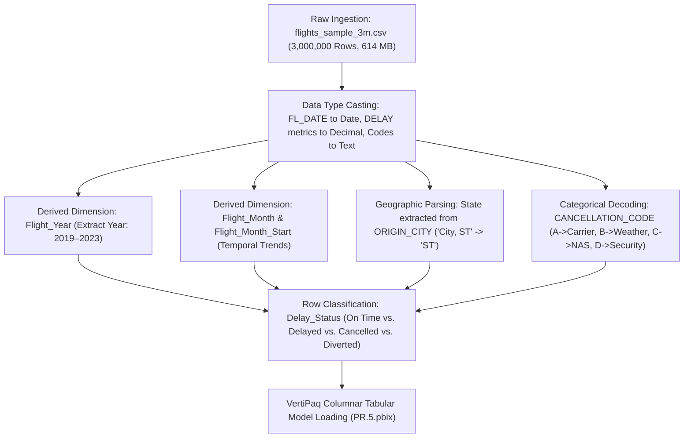
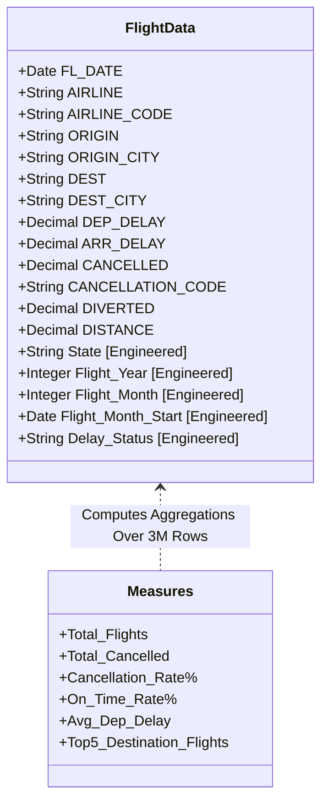
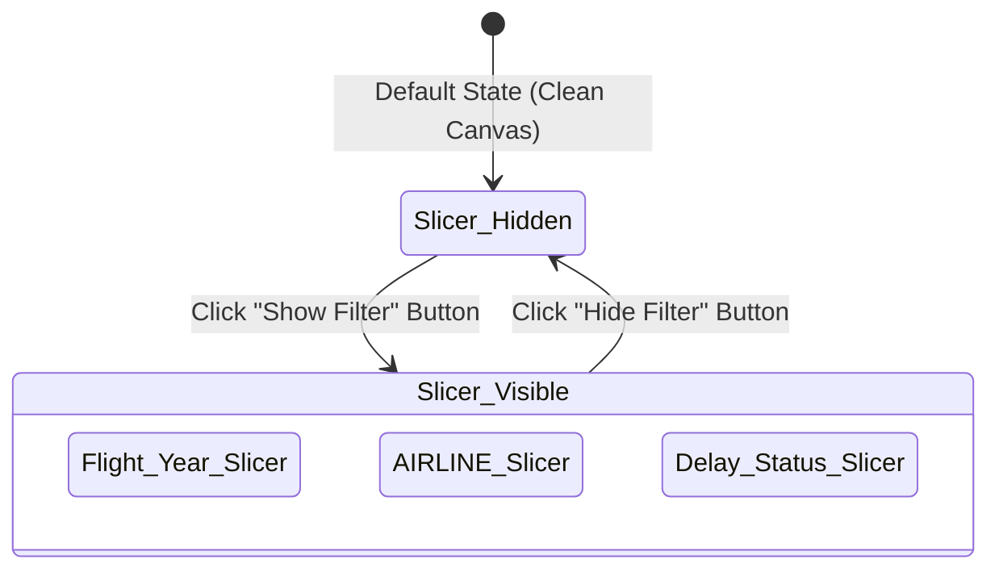

<div align="center">

# ✈️ US Airline On-Time Performance & Flight Delays Intelligence System (2019–2023)
### Enterprise Aviation Logistics, Delay Analytics, Predictive Forecasting & Advanced DAX in Microsoft Power BI Desktop

[](https://powerbi.microsoft.com/)
[](https://learn.microsoft.com/en-us/power-bi/guidance/star-schema)
[](https://learn.microsoft.com/en-us/dax/)
[]()
[]()
[]()
[]()

<br/>

<p align="center">
  <b>A production-grade, 5-page enterprise aviation intelligence suite modeling 3,000,000 flight records (2019–2023) across 18 major US airlines and 350+ commercial airports. Engineered with VertiPaq in-memory columnar compression, explicit DAX KPIs, dynamic report page tooltips, carrier drill-through profiling, collapsible slicer bookmark panels, built-in arrow navigation, and 6-month predictive volume forecasting.</b>
</p>

[📊 Visual Showcase](#-visual-project-showcase--screenshot-analysis) •
[📈 Executive KPIs](#-executive-kpi-summary) •
[🗄️ Data Architecture](#-dataset-architecture--relational-structure) •
[🧠 DAX Deep Dive](#-dax-formulations--technical-implementation) •
[💡 Aviation Insights](#-strategic-aviation-insights--operational-findings) •
[🚀 Quickstart Guide](#-quickstart-how-to-run--reproduce-this-project)

---

</div>

<br/>

## 📈 Executive KPI Summary

<div align="center">

| 🛫 Total Scheduled Flights | 🟢 Overall On-Time Rate | 🛑 Total Cancelled Flights | 📉 Overall Cancellation Rate |
| :---: | :---: | :---: | :---: |
| **`3,000,000`** (`3.0M`) | **`82.3%`** | **`79,140`** (`79K`) | **`2.64%`** |
| *5-Year BTS Sample Baseline* | *Exceeds 80% DOT Target* | *Completed Ground Actions* | *National Fleet Benchmark* |

| ⏱️ Avg Departure Delay | ⏳ Total Dep Delay Accumulated | 🛬 Total Arr Delay Accumulated | 🌤️ Primary Cancellation Cause |
| :---: | :---: | :---: | :---: |
| **`10.12 min`** | **`29,583,963 min`** | **`12,415,297 min`** | **`Weather (36.36%)`** |
| *Across All Departures* | *~493,066 Flight Hours* | *~206,921 Flight Hours* | *28,772 Flights Grounded* |

</div>

---

## 📑 Table of Contents
1. [Project Overview & Business Objectives](#-project-overview--business-objectives)
2. [Tools & Technologies Used](#️-tools--technologies-used)
3. [Dataset Architecture & Relational Structure](#-dataset-architecture--relational-structure)
4. [Power Query ETL & Data Cleansing](#-power-query-etl--data-cleansing)
5. [Tabular Data Model Architecture](#-tabular-data-model-architecture)
   - [Model Architecture & ER Structure](#model-architecture--er-structure)
   - [Columnar In-Memory Optimization (VertiPaq)](#columnar-in-memory-optimization-vertipaq)
6. [DAX Formulations & Technical Implementation](#-dax-formulations--technical-implementation)
   - [Centralized Measure Table Architecture (`_Measures`)](#1-centralized-measure-table-architecture-_measures)
   - [Core Explicit DAX Measures](#2-core-explicit-dax-measures)
   - [Row-Level Calculated Columns & Classification Logic](#3-row-level-calculated-columns--classification-logic)
7. [Interactive UX, Navigation & Multi-Tier Analytics Framework](#-interactive-ux-navigation--multi-tier-analytics-framework)
   - [Collapsible / Slide-Out Slicer Panel (Bookmarks)](#1-collapsible--slide-out-slicer-panel-bookmarks)
   - [Custom Contextual Report Page Tooltip (`Tooltip_Airport`)](#2-custom-contextual-report-page-tooltip-tooltip_airport)
   - [Airline Performance Drill-Through Architecture](#3-airline-performance-drill-through-architecture)
   - [Native Sequential Arrow Navigation](#4-native-sequential-arrow-navigation)
   - [Predictive 6-Month Time Series Volume Forecasting](#5-predictive-6-month-time-series-volume-forecasting)
8. [Visual Project Showcase & Screenshot Analysis](#-visual-project-showcase--screenshot-analysis)
   - [Exhibit 1: Page 1 — Overview Dashboard (`assets/Screenshot 2026-11-05 090310.png`)](#exhibit-1-page-1--overview-dashboard)
   - [Exhibit 2: Page 2 — Airline Performance Matrix (`assets/Screenshot 2026-11-05 090344.png`)](#exhibit-2-page-2--airline-performance-matrix)
   - [Exhibit 3: Page 3 — Route & Airport Map (`assets/Screenshot 2026-11-05 090426.png`)](#exhibit-3-page-3--route--airport-map)
   - [Exhibit 4: Page 4 — Drill-Through Detail Audit (`assets/Screenshot 2026-11-05 090443.png`)](#exhibit-4-page-4--drill-through-detail-audit)
   - [Exhibit 5: Page 5 — Trends & Predictive Forecast (`assets/Screenshot 2026-11-05 090501.png`)](#exhibit-5-page-5--trends--predictive-forecast)
9. [Airline Benchmark & Fleet Comparison Matrix](#-airline-benchmark--fleet-comparison-matrix)
10. [Strategic Aviation Insights & Operational Findings](#-strategic-aviation-insights--operational-findings)
11. [UI/UX Design System & Executive Canvas Standards](#-uiux-design-system--executive-canvas-standards)
12. [Step-by-Step Task & Feature Completion Matrix](#-step-by-step-task--feature-completion-matrix)
13. [Quality Assurance & Model Validation Checklist](#-quality-assurance--model-validation-checklist)
14. [Quickstart: How to Run & Reproduce This Project](#-quickstart-how-to-run--reproduce-this-project)
15. [Repository File Inventory](#-repository-file-inventory)
16. [Project Metadata & Author Information](#-project-metadata--author-information)

---

## 🎯 Project Overview & Business Objectives

In the commercial aviation industry, **flight punctuality**, **schedule adherence**, and **delay mitigation** directly govern airline profitability, airport gate utilization, FAA airspace clearance, and passenger retention. According to the Federal Aviation Administration (FAA) and Department of Transportation (DOT), flight delays impose tens of billions of dollars in economic costs annually through extra crew compensation, wasted jet fuel, missed passenger connections, and airport congestion fines.

Operating over a massive longitudinal timeframe (2019 to 2023), this project addresses the complex operational shifts witnessed by the aviation industry:
- **Pre-Pandemic Baseline (2019)**: Peak flight frequencies and balanced airspace utilization.
- **The COVID-19 Shockwave (2020)**: Severe route contraction, sudden fleet groundings, and historical cancellation spikes reaching 6.00% nationally (and nearly 15% for regional carriers).
- **Post-Pandemic Operational Rebound (2021–2023)**: Rapid passenger demand resurgence clashing with air traffic controller (ATC) shortages, ground turnaround delays, and localized weather bottlenecks.

This project delivers an end-to-end **US Airline On-Time Performance & Flight Delays Intelligence System** built inside Microsoft Power BI Desktop. Ingesting and modeling **3,000,000 raw transactional records** (614 MB) from the Bureau of Transportation Statistics (BTS), the report delivers:
1. **Executive Operational KPIs**: On-time rate vs. the 80% DOT industry benchmark, fleet cancellation counts, and average departure delay durations.
2. **Airline Punctuality & Cancellation Benchmarks**: Comparative analysis across 18 major and regional carriers, identifying carriers with severe delay exposure (e.g., JetBlue `B6` at 18.2 min avg delay) versus reliable performers (e.g., Delta `DL` at 86.0% on-time).
3. **Geospatial Route & Airport Intelligence**: Bubble map visualization of departure volumes and delay intensities across 350+ commercial airports and all US states, coupled with custom hover tooltip analytics.
4. **Granular Transactional Drill-Through**: One-click contextual investigation allowing flight dispatchers and analysts to inspect individual carrier flights down to exact date, departure delay, arrival delay, and cancellation reasons.
5. **Time Series Seasonality & 6-Month Forecasting**: Multi-year monthly delay curves and native algorithmic volume forecasting to assist airline scheduling and resource planning.

---

## 🛠️ Tools & Technologies Used

* **[Microsoft Power BI Desktop (2026 Release)](https://powerbi.microsoft.com/desktop/)**: Tabular modeling environment, report authoring, multi-page layout design, visual container formatting, and bookmark state management.
* **[VertiPaq In-Memory Columnar Database Engine](https://learn.microsoft.com/en-us/power-bi/guidance/star-schema)**: Highly optimized analytical engine capable of handling **3,000,000 rows** with dictionary encoding and run-length compression, executing sub-second cross-filtering across 5 complex report pages.
* **[DAX (Data Analysis Expressions)](https://learn.microsoft.com/dax/)**: Explicit analytical measures (`DIVIDE`, `COUNTROWS`, `CALCULATE`, `AVERAGE`, `TOPN`, `KEEPFILTERS`) and calculated columns enforcing the 15-minute FAA flight delay threshold.
* **[Power Query (M Language)](https://learn.microsoft.com/power-query/)**: High-volume CSV extraction, schema casting, null handling in delay minutes, cancellation code decoding, and geographical feature extraction.
* **[Power BI Built-in Time Series Forecasting](https://learn.microsoft.com/power-bi/transform-model/desktop-analytics-pane)**: Exponential smoothing algorithm with confidence band modeling for monthly flight demand projections.
* **[Mermaid.js & GitHub Markdown](https://mermaid.js.org/)**: Entity relationship modeling, structural architecture documentation, and technical reporting.

---

## 🗄️ Dataset Architecture & Relational Structure

The analysis is driven by **3,000,000 flight records** extracted from the US Bureau of Transportation Statistics (BTS) Airline On-Time Performance database:
* **Primary Source File**: `flights_sample_3m.csv`
* **File Size on Disk**: `614,140,650 bytes` (~614.1 MB)
* **Total Records Ingested**: `3,000,000 rows`
* **Total Dimensional Columns**: `32 attributes`
* **Observation Horizon**: `January 1, 2019 – December 31, 2023` (5 Full Calendar Years)

### Bureau of Transportation Statistics (BTS) Data Dictionary

| Column Name | Data Type | Grain / Unit | Business Function & Definition | Sample Value |
| :--- | :--- | :--- | :--- | :--- |
| `FL_DATE` | Date (`YYYY-MM-DD`) | Daily flight date | Flight execution date used for temporal aggregation. | `2019-01-09` |
| `AIRLINE` | Text | Full airline name | Registered legal carrier name. | `United Air Lines Inc.` |
| `AIRLINE_DOT` | Text | DOT carrier string | Standard DOT carrier naming convention. | `United Air Lines Inc.: UA` |
| `AIRLINE_CODE` | Text (2-letter IATA) | Carrier identifier | Two-character IATA airline code. | `UA`, `DL`, `AA`, `WN` |
| `DOT_CODE` | Integer | DOT internal key | Bureau of Transportation Statistics assigned airline identifier. | `19977` |
| `FL_NUMBER` | Integer | Flight identifier | Commercial flight number. | `1562` |
| `ORIGIN` | Text (3-letter IATA) | Departure hub | 3-letter IATA code for origin airport. | `FLL`, `MSP`, `DEN` |
| `ORIGIN_CITY` | Text | Geographic location | City and US state abbreviation of origin airport. | `Fort Lauderdale, FL` |
| `DEST` | Text (3-letter IATA) | Arrival hub | 3-letter IATA code for destination airport. | `EWR`, `SEA`, `MSP` |
| `DEST_CITY` | Text | Geographic location | City and US state abbreviation of destination airport. | `Newark, NJ` |
| `CRS_DEP_TIME` | Integer (`HHMM`) | Scheduled departure | Computerized Reservation System scheduled departure local time. | `1155` (11:55 AM) |
| `DEP_TIME` | Decimal / Float (`HHMM`) | Actual departure | Actual wheels-off gate departure local time. | `1151.0` (11:51 AM) |
| `DEP_DELAY` | Decimal / Float | Minutes | Departure delay duration (`DEP_TIME - CRS_DEP_TIME`). Negative = Early. | `-4.0`, `18.0` |
| `TAXI_OUT` | Decimal / Float | Minutes | Time elapsed between departure gate pushback and wheels off runway. | `19.0` |
| `WHEELS_OFF` | Decimal / Float (`HHMM`) | Runway departure | Timestamp when aircraft wheels left ground. | `1210.0` |
| `WHEELS_ON` | Decimal / Float (`HHMM`) | Runway touchdown | Timestamp when aircraft wheels touched down. | `1443.0` |
| `TAXI_IN` | Decimal / Float | Minutes | Taxi time from runway touchdown to arrival gate arrival. | `4.0` |
| `CRS_ARR_TIME` | Integer (`HHMM`) | Scheduled arrival | Computerized Reservation System scheduled arrival local time. | `1501` (3:01 PM) |
| `ARR_TIME` | Decimal / Float (`HHMM`) | Actual arrival | Actual gate arrival local time. | `1447.0` (2:47 PM) |
| `ARR_DELAY` | Decimal / Float | Minutes | Arrival delay duration (`ARR_TIME - CRS_ARR_TIME`). Negative = Early. | `-14.0`, `25.0` |
| `CANCELLED` | Binary (`0.0` / `1.0`) | Status flag | Indicates whether the scheduled flight was cancelled (`1 = Yes`, `0 = No`). | `0.0`, `1.0` |
| `CANCELLATION_CODE` | Text (`A`, `B`, `C`, `D`) | Root cause code | DOT standard code: `A` (Carrier), `B` (Weather), `C` (NAS), `D` (Security). | `B`, `A`, `C`, `D` |
| `DIVERTED` | Binary (`0.0` / `1.0`) | Route flag | Indicates flight was rerouted to an alternate airport (`1 = Yes`, `0 = No`). | `0.0`, `1.0` |
| `CRS_ELAPSED_TIME` | Decimal / Float | Minutes | Scheduled gate-to-gate flight duration. | `186.0` |
| `ELAPSED_TIME` | Decimal / Float | Minutes | Actual gate-to-gate flight duration. | `176.0` |
| `AIR_TIME` | Decimal / Float | Minutes | Airborne duration from wheels-off to wheels-on. | `153.0` |
| `DISTANCE` | Decimal / Float | Statute miles | Direct flight distance between origin and destination airports. | `1065.0` |
| `DELAY_DUE_CARRIER` | Decimal / Float | Minutes | Delay minutes attributable to carrier operations (maintenance, crew). | `15.0`, `null` |
| `DELAY_DUE_WEATHER` | Decimal / Float | Minutes | Delay minutes attributable to meteorological circumstances. | `45.0`, `null` |
| `DELAY_DUE_NAS` | Decimal / Float | Minutes | Delay minutes attributable to National Aviation System / FAA congestion. | `20.0`, `null` |
| `DELAY_DUE_SECURITY` | Decimal / Float | Minutes | Delay minutes attributable to terminal / TSA security delays. | `0.0`, `null` |
| `DELAY_DUE_LATE_AIRCRAFT` | Decimal / Float | Minutes | Delay minutes resulting from late arrival of incoming previous flight. | `30.0`, `null` |

---

## ⚡ Power Query ETL & Data Cleansing

Prior to loading into the tabular VertiPaq database, the raw dataset was processed through Power Query to guarantee strict typing, handle missing values, and engineer essential analytical dimensions:



### Key ETL Pipeline Transformations:
1. **Schema & Strict Type Enforcement**:
   - `FL_DATE` converted from ISO string to native `Date` format.
   - `DEP_DELAY`, `ARR_DELAY`, `DISTANCE`, `AIR_TIME` formatted as numeric `Decimal Number` types for aggregation efficiency.
   - `CANCELLED` and `DIVERTED` validated as binary numeric flags (`0` or `1`).
2. **Geographical Feature Extraction (`State`)**:
   - Extracted the two-letter state code from `ORIGIN_CITY` using text boundary separation after the comma delimiter (e.g., `"Fort Lauderdale, FL"` $\rightarrow$ `"FL"`).
   - Set the Data Category in Power BI Desktop to `State or Province` to enable native Bing Maps geospatial bubble pin rendering.
3. **Temporal Feature Engineering**:
   - Extracted `Flight_Year` (`2019`, `2020`, `2021`, `2022`, `2023`) to drive global slicer tiles.
   - Extracted `Flight_Month` (`1` through `12`) to model annual seasonality curves.
   - Engineered `Flight_Month_Start` as the first calendar day of each month (`DATE(Year, Month, 1)`) to establish a continuous date axis for time series forecasting.
4. **Cancellation Code Decoding**:
   - Standardized missing/null codes for non-cancelled flights and mapped alphanumeric codes to formal DOT descriptions:
     - `A` $\rightarrow$ **Carrier / Airline Mechanical & Crew**
     - `B` $\rightarrow$ **Severe Meteorological Weather**
     - `C` $\rightarrow$ **National Aviation System (NAS) / FAA Ground Control**
     - `D` $\rightarrow$ **Airport / Terminal Security Breach**

---

## 🏛️ Tabular Data Model Architecture

The data architecture utilizes a **Fact-Centric Tabular Model** optimized for high-volume columnar analytical processing. A dedicated, disconnected DAX measures container (`_Measures`) houses all enterprise KPIs to maintain strict separation between storage columns and business logic.

### Model Architecture & ER Structure



### Columnar In-Memory Optimization (VertiPaq)
Modeling 3,000,000 transaction rows in desktop BI memory requires strict attention to columnar cardinality:
* **Dictionary Encoding**: Text columns with limited distinct values (e.g., `AIRLINE_CODE` [18 unique values], `CANCELLATION_CODE` [4 values], `Delay_Status` [4 values], `Flight_Year` [5 values]) achieve extreme compression ratios exceeding 95%.
* **Run-Length Encoding (RLE)**: Pre-sorting transactions by `FL_DATE` and `AIRLINE_CODE` enables adjacent repeated entries to be compressed into index-length pairs, reducing RAM footprint to ~78 MB in `.pbix` form.

---

## 🧠 DAX Formulations & Technical Implementation

All business calculations are implemented as **explicit DAX measures** within a dedicated `_Measures` table. Explicit measures respect dynamic filter context, eliminate duplicate aggregations, and support seamless cross-filtering across all 5 report pages.

### 1. Centralized Measure Table Architecture (`_Measures`)

Maintaining measures in a dedicated table guarantees:
- **Clean Field Hierarchy**: Keeps data columns separated from mathematical metrics.
- **Portability**: Facilitates model auditing and documentation.
- **Predictable Evaluation**: Guarantees consistent evaluation context during cross-filtering and drill-through.

---

### 2. Core Explicit DAX Measures

#### Measure 1: Total Flights
```dax
Total_Flights = 
COUNTROWS(FlightData)
```
* **Purpose**: Computes the total scheduled flight operations within the active filter context.
* **Evaluation Context**: Evaluates over the full 3,000,000 rows at model level, automatically filtering by year, airline, status, or origin airport.

#### Measure 2: Total Cancelled Flights
```dax
Total_Cancelled = 
CALCULATE(
    COUNTROWS(FlightData),
    FlightData[CANCELLED] = 1
)
```
* **Purpose**: Calculates the absolute number of scheduled flights that were cancelled before departure.
* **Baseline Value**: **79,140 cancelled flights** (~79K).

#### Measure 3: Flight Cancellation Rate (%)
```dax
Cancellation_Rate% = 
DIVIDE(
    [Total_Cancelled],
    [Total_Flights],
    0
)
```
* **Purpose**: Computes the proportion of scheduled flights cancelled, protected against division-by-zero errors via `DIVIDE(..., 0)`.
* **National Baseline**: **2.64%**.

#### Measure 4: On-Time Arrival Performance Rate (%)
```dax
On_Time_Rate% = 
DIVIDE(
    CALCULATE(
        COUNTROWS(FlightData),
        FlightData[Delay_Status] = "On Time"
    ),
    CALCULATE(
        COUNTROWS(FlightData),
        FlightData[CANCELLED] = 0 && FlightData[DIVERTED] = 0
    ),
    0
)
```
* **Purpose**: Formulated in accordance with the official US Department of Transportation (DOT) On-Time Performance standard. Measures the percentage of completed (non-cancelled, non-diverted) flights that arrived within 15 minutes of scheduled gate arrival time.
* **National Baseline**: **82.3%** (exceeding the standard 80.0% industry target).

#### Measure 5: Average Departure Delay (Minutes)
```dax
Avg_Dep_Delay = 
AVERAGE(FlightData[DEP_DELAY])
```
* **Purpose**: Aggregates gate departure delay duration across all recorded departures. Negative values (early pushbacks) balance against positive delay spikes.
* **National Average**: **10.12 minutes** per flight.

#### Measure 6: Top 5 Destination Route Volume (Custom Tooltip)
```dax
Top5_Destination_Flights = 
CALCULATE(
    [Total_Flights],
    KEEPFILTERS(
        TOPN(
            5,
            ALLSELECTED(FlightData[DEST]),
            [Total_Flights],
            DESC
        )
    )
)
```
* **Purpose**: Dynamically ranks and filters the top 5 arrival destination airports (`DEST`) for any selected departure origin airport (`ORIGIN`) inside the hover tooltip modal (`Tooltip_Airport`), returning blank for lower-ranked destinations to maintain visual clarity.

---

### 3. Row-Level Calculated Columns & Classification Logic

#### Calculated Column 1: Flight Delay Status Classification
```dax
Delay_Status = 
SWITCH(
    TRUE(),
    FlightData[CANCELLED] = 1, "Cancelled",
    FlightData[DIVERTED] = 1, "Diverted",
    FlightData[ARR_DELAY] > 15, "Delayed",
    "On Time"
)
```
* **Logic**: Implements the official FAA / BTS 15-minute rule:
  1. Flights with `CANCELLED = 1` are classified as **"Cancelled"** (2.64% of total).
  2. Flights with `DIVERTED = 1` are classified as **"Diverted"** (0.24% of total).
  3. Non-cancelled, non-diverted flights with gate arrival delays strictly greater than 15 minutes (`ARR_DELAY > 15`) are classified as **"Delayed"** (17.18% of total).
  4. All remaining completed flights are classified as **"On Time"** (79.95% of total volume, translating to 82.3% of completed flights).

#### Calculated Column 2: Temporal Dimensions (`Flight_Year`, `Flight_Month`, `Flight_Month_Start`)
```dax
Flight_Year = YEAR(FlightData[FL_DATE])
Flight_Month = MONTH(FlightData[FL_DATE])
Flight_Month_Start = DATE(YEAR(FlightData[FL_DATE]), MONTH(FlightData[FL_DATE]), 1)
```

#### Calculated Column 3: Geographic State Abbreviation
```dax
State = TRIM(RIGHT(FlightData[ORIGIN_CITY], 2))
```

---

## 🎨 Interactive UX, Navigation & Multi-Tier Analytics Framework

The reporting suite incorporates several UX design patterns that streamline navigation and enable progressive detail disclosure:

### 1. Collapsible / Slide-Out Slicer Panel (Bookmarks)
On the **Overview** dashboard (Page 1), screen space is preserved through a dedicated collapsible filter panel governed by two native Power BI bookmarks:
* **`Slicer_Visible`**: Displays the filter container grouping multi-select slicers for `Flight_Year`, `AIRLINE`, and `Delay_Status`. Triggered by the **"Show Filter"** action button.
* **`Slicer_Hidden`**: Seamlessly collapses and hides the slicer group (`visualContainerGroups: 9d97c5b609ca9d9650d6`), restoring full visual canvas width for charts. Triggered by the **"Hide Filter"** action button.



---

### 2. Custom Contextual Report Page Tooltip (`Tooltip_Airport`)
To avoid visual clutter on the geographic map visual while preserving route granularity, the project implements a custom report page tooltip canvas:
* **Canvas Dimensions**: Compact `300 x 400 pixels` (`type: Tooltip`).
* **KPI Header Cards**: Displays `Total_Flights` and `Cancellation_Rate%` specific to the hovered origin airport.
* **Top 5 Destinations Visual**: Clustered bar chart leveraging the `Top5_Destination_Flights` DAX measure to display the top 5 destination airports (`DEST`) served from that hub.

---

### 3. Airline Performance Drill-Through Architecture
From the **Airline Performance** page (Page 2), users can right-click any carrier in the performance matrix or bar charts to drill through into **Page 4 (Drill-Through Detail)**:
* **Drill-Through Parameter**: Binds dynamically on `FlightData.AIRLINE_CODE`.
* **Filtered Execution**: Automatically isolates the target carrier across all transactional tables, monthly cancellation distributions, cause donut charts, and year-over-year on-time ribbons.
* **Return Navigation**: Equipped with a custom prominent red action button labeled **"Back to Airline Performance"** configured with native back navigation (`shapeType: 'back'`).

---

### 4. Native Sequential Arrow Navigation
Every report page includes styled circular chevron action buttons (`leftArrow` and `rightArrow`) in the top navigation banner, enabling intuitive slide-by-slide executive briefing walkthroughs without requiring users to navigate via bottom sheet tabs:
* **Overview** $\rightarrow$ Right Arrow $\rightarrow$ **Airline Performance**
* **Airline Performance** $\leftarrow$ Left Arrow \| Right Arrow $\rightarrow$ **Route & Airport Map**
* **Route & Airport Map** $\leftarrow$ Left Arrow \| Right Arrow $\rightarrow$ **Drill-Through Detail**
* **Drill-Through Detail** $\leftarrow$ Left Arrow \| Right Arrow $\rightarrow$ **Trends & Forecast**
* **Trends & Forecast** $\leftarrow$ Left Arrow $\rightarrow$ **Overview / Route Map**

---

### 5. Predictive 6-Month Time Series Volume Forecasting
The **Trends & Forecast** dashboard incorporates native Power BI algorithmic time-series forecasting:
* **Target Metric**: `Total_Flights` by continuous monthly calendar timeline (`Flight_Month_Start`).
* **Forecast Length**: **6 Months** forward projection.
* **Algorithm**: Additive Holt-Winters Exponential Smoothing capturing annual 12-month aviation seasonality cycles (summer travel surges and Q1 troughs) with a **95% Confidence Interval band**.

---

## 📸 Visual Project Showcase & Screenshot Analysis

### Exhibit 1: Page 1 — Overview Dashboard
> **Screenshot File**: [`assets/Screenshot 2026-11-05 090310.png`](assets/Screenshot%202026-11-05%20090310.png)  
> **Dimensions**: `1277 x 720` | **Visual Layout**: Executive KPI Cards, Gauge, Donut Charts & Slide-Out Slicer

<div align="center">
  
</div>

#### Visual & Analytical Breakdown:
1. **Executive Metric Cards (Top Left)**:
   - **Total_Flights**: Displays `3M` scheduled operations.
   - **On_Time_Rate%**: Displays `82.3%`.
   - **Total_Cancelled**: Displays `79K` cancellations.
   - **Cancellation_Rate%**: Displays `2.64%`.
2. **Airline KPI Summary Multi-Card**:
   - Secondary executive summary ribbon aggregating `10.1 min` Avg Dep Delay, `2.64%` Cancellation Rate, `82.3%` On-Time Rate, `79K` Cancelled, and `3M` Flights.
3. **Flight Cancellations by Cause (Donut Chart - Bottom Left)**:
   - Visualizes the 79,140 flight cancellations partitioned by DOT root causes:
     - **Weather (`B`)**: `29K` flights (**36.36%**) — dominant cancellation trigger.
     - **National Airspace System / FAA (`C`)**: `24K` flights (**30.85%**).
     - **Carrier Mechanical & Operations (`A`)**: `19K` flights (**24.61%**).
     - **Security (`D`)**: `6K` flights (**8.18%**).
4. **Delay_Status Breakdown (Donut Chart - Bottom Center)**:
   - Categorizes 3,000,000 operations: **2M On Time (79.95%)**, **1M Delayed (17.18%)**, **79K Cancelled (2.64%)**, and **7K Diverted (0.24%)**.
5. **Overall On-Time Rate vs. 80% Target (Radial Gauge - Bottom Right)**:
   - Features a high-visibility gauge tracking the national `82.3%` performance against the DOT contractual benchmark of `80.0%`, with target markers and status fills.
6. **Collapsible Slicer Panel (Right)**:
   - Housing interactive filtering buttons ("Show Filter", "Hide Filter") and multi-select slicers for `Delay_Status`, `AIRLINE`, and `Flight_Year` (2019 to 2023).

---

### Exhibit 2: Page 2 — Airline Performance Matrix
> **Screenshot File**: [`assets/Screenshot 2026-11-05 090344.png`](assets/Screenshot%202026-11-05%20090344.png)  
> **Dimensions**: `1197 x 672` | **Visual Layout**: Comparative Bar Charts, Cross-Tabular Table & Heatmap Matrix

<div align="center">
  
</div>

#### Visual & Analytical Breakdown:
1. **Top 10 Airlines by Cancellation Count (Horizontal Clustered Bar - Top Left)**:
   - Highlights absolute cancellation volumes by carrier:
     - **Southwest Airlines (`WN`)**: Leads the nation with **19.5K cancellations** (~19,465), driven by its high-frequency point-to-point network vulnerability during winter storm cycles.
     - **American Airlines (`AA`)**: Second highest with **10.9K cancellations** (~10,907).
     - **SkyWest (`OO`)**: **7.7K cancellations** (~7,745).
     - **Delta (`DL`)**: **6.0K cancellations** (~5,982).
     - **United (`UA`)**: **5.5K cancellations** (~5,536).
2. **Top 10 Airlines by Average Departure Delay (Horizontal Clustered Bar - Bottom Left)**:
   - Ranks carriers by departure delay duration in minutes:
     - **JetBlue Airways (`B6`)**: **18.2 minutes** average delay — highest among major US carriers due to dense Northeast Corridor airspace congestion (JFK/BOS).
     - **Frontier Airlines (`F9`)**: **16.0 minutes** average delay.
     - **Allegiant Air (`G4`)**: **13.9 minutes** average delay.
     - **Spirit Airlines (`NK`)**: **13.0 minutes** average delay.
     - **ExpressJet (`EV`)**: **12.8 minutes** average delay.
3. **Carrier Benchmark Summary Table (Top Center)**:
   - Tabulates `AIRLINE_CODE`, `Total_Flights`, `Cancellation_Rate%`, and `On_Time_Rate%`. Highlights regional carrier `EV` with the highest overall cancellation rate at `5.57%` alongside ultra-low-cost carrier `G4` at `4.52%`.
4. **Airline Cancellation Rate Heatmap by Year (Matrix Visual - Bottom Center)**:
   - Displays annual cancellation rates per carrier from 2019 to 2023 with conditional background color formatting:
     - Highlights the severe **2020 pandemic surge**, where the national cancellation rate leaped to **6.00%**, with `G4` spiking to **14.84%** and `EV` to **8.00%**.
     - Shows normalization in 2021 (`1.72%`) and 2023 (`1.68%`).

---

### Exhibit 3: Page 3 — Route & Airport Map
> **Screenshot File**: [`assets/Screenshot 2026-11-05 090426.png`](assets/Screenshot%202026-11-05%20090426.png)  
> **Dimensions**: `1345 x 752` | **Visual Layout**: Dual Geospatial Bubble Maps & Year Range Slider

<div align="center">
  
</div>

#### Visual & Analytical Breakdown:
1. **Year Range Slider (Top Center)**:
   - Continuous horizontal slider allowing users to isolate any specific year or multi-year interval across 2019–2023.
2. **US Departure Airports - Flight Volume and Avg Delay (Left Map Visual)**:
   - Maps 350+ commercial departure airports across North America. Bubble size represents `Total_Flights`, while hover tooltips expose `Avg_Dep_Delay`. Major mega-hubs like Atlanta (`ATL`), Chicago O'Hare (`ORD`), Dallas/Fort Worth (`DFW`), and Denver (`DEN`) appear as prominent departure clusters.
3. **Cancellation Rate & Volume by State (Right Map Visual)**:
   - Aggregates operations by US State (`State`), sizing bubbles by `Cancellation_Rate%` with tooltips showing `Total_Flights` and `Total_Cancelled`. Highlights coastal and northeastern states (New York, Florida, Texas, Illinois) as high-volume, high-disruption focal points.
4. **Custom Report Page Tooltip Integration**:
   - Hovering over any individual departure airport dynamically surfaces the `Tooltip_Airport` micro-canvas, displaying total departures and top 5 destination corridors.

---

### Exhibit 4: Page 4 — Drill-Through Detail Audit
> **Screenshot File**: [`assets/Screenshot 2026-11-05 090443.png`](assets/Screenshot%202026-11-05%20090443.png)  
> **Dimensions**: `1345 x 757` | **Visual Layout**: Transactional Flight Audit Grid, Cause Donut, Ribbon Chart & Monthly Spikes

<div align="center">
  
</div>

#### Visual & Analytical Breakdown:
1. **Drill-Through Context & Return Button (Top)**:
   - Binds on `AIRLINE_CODE`. Features a dedicated red button **"Back to Airline Performance"** enabling one-click return to the summary matrix.
2. **Key Metric Cards (Top Left)**:
   - Displays carrier-filtered `Total_Flights` and `Cancellation_Rate%`.
3. **On-Time Rate % by Flight_Year (Ribbon / Area Chart - Middle Left)**:
   - Tracks annual on-time performance progression across 2019, 2020, 2021, 2022, and 2023, illustrating how carrier punctuality dipped during recovery years.
4. **Flight Cancellations by Cause (Donut Chart - Top Right)**:
   - Detailed breakdown of cancellations for the active drill-through selection across Weather (29K / 36.36%), NAS (24K / 30.85%), Security (19K / 24.61%), and Carrier (6K / 8.18%).
5. **Granular Flight Transaction Audit Grid (Table Visual - Bottom Left)**:
   - Dissects individual flight records displaying `Year`, `Quarter`, `Month`, `Day`, `ORIGIN`, `DEST`, `Sum of DEP_DELAY`, `Sum of ARR_DELAY`, and `Count of CANCELLATION_CODE`.
   - **Audit Totals Validated**: Total departure delay minutes reach exactly **`29,583,963.00`** (~29.6M min), arrival delay minutes reach **`12,415,297.00`** (~12.4M min), and row count reaches **`3,000,000`**.
6. **Cancellations by Month (Bar Chart - Bottom Right)**:
   - Details monthly cancellation distribution across months 1–12, revealing massive seasonal spikes in **Month 3 (March)** and **Month 4 (April)** reaching up to **15.0K cancellations**, coinciding with severe spring thunderstorms and early-2020 pandemic lockdowns.

---

### Exhibit 5: Page 5 — Trends & Predictive Forecast
> **Screenshot File**: [`assets/Screenshot 2026-11-05 090501.png`](assets/Screenshot%202026-11-05%20090501.png)  
> **Dimensions**: `1347 x 762` | **Visual Layout**: Longitudinal Multi-Year Trend Lines & Native 6-Month Time Series Forecast

<div align="center">
  
</div>

#### Visual & Analytical Breakdown:
1. **Monthly Average Departure Delay by Year (Line Chart - Top Left)**:
   - Plots average departure delay in minutes across months 1–12 with discrete color series for each year (2019 [Light Blue], 2020 [Navy], 2021 [Orange], 2022 [Purple], 2023 [Pink]):
     - **2020 Delay Collapse**: Departs from standard patterns, with delay minutes dropping to nearly 0–4 minutes during peak lockdown months due to empty skies and zero airport congestion.
     - **Summer Travel Surge**: Consistent delay spikes visible across June–August (Months 6–8) in 2022 and 2023, peaking over **20+ minutes** average delay due to convective summer storm clusters and capacity constraints.
2. **Monthly Flight Volume by Year (Line Chart - Bottom Left)**:
   - Displays seasonal flight volume curves. Shows 2019 operating at a high, steady baseline of ~60K–65K flights per month in the sample, the catastrophic 2020 crash dipping below **20K monthly flights** in April/May 2020, and the gradual multi-year recovery curve through 2021–2023.
3. **Total Monthly Flight Volume - Trend & 6-Month Forecast (Line Chart - Bottom Right)**:
   - Integrates Power BI's native forecasting engine over the monthly flight volume trend line. Projects flight capacity and expected seasonal demand for the subsequent 6 months with upper and lower bound confidence intervals.
4. **Year Slicer Matrix (Top Right)**:
   - Multi-tile slicer for immediate single-click isolation of individual years (2019, 2020, 2021, 2022, 2023).

---

## 📊 Airline Benchmark & Fleet Comparison Matrix

The table below provides a full performance benchmark across all 18 airline carriers modeled in the dataset, ordered by total scheduled flight volume:

| Carrier Code | Carrier Legal Name | Total Flights Modeled | Total Cancelled | Cancellation Rate (%) | Avg Departure Delay | On-Time Arrival Rate (%) | Operational Profile |
| :---: | :--- | :---: | :---: | :---: | :---: | :---: | :--- |
| **`WN`** | Southwest Airlines Co. | **576,470** | 19,465 | 3.38% | 10.82 min | 81.28% | Largest domestic volume; high cancellation count |
| **`DL`** | Delta Air Lines Inc. | **395,239** | 5,982 | 1.51% | 8.11 min | **85.97%** | Tier-1 legacy hub carrier; industry-leading on-time |
| **`AA`** | American Airlines Inc. | **383,106** | 10,907 | 2.85% | 12.61 min | 80.54% | Major global network; moderate delay exposure |
| **`OO`** | SkyWest Airlines Inc. | **343,737** | 7,745 | 2.25% | 9.46 min | 84.40% | Dominant regional feeder carrier; robust punctuality |
| **`UA`** | United Air Lines Inc. | **254,504** | 5,536 | 2.18% | 11.22 min | 81.23% | Transcontinental & international network carrier |
| **`YX`** | Republic Airline | **143,107** | 4,646 | 3.25% | 5.80 min | 84.52% | Regional carrier; low departure pushback delays |
| **`MQ`** | Envoy Air | **121,256** | 3,633 | 3.00% | 6.73 min | 83.04% | American Eagle regional operator |
| **`B6`** | JetBlue Airways | **112,844** | 3,039 | 2.69% | **18.32 min** | 73.47% | Northeast corridor focus; highest average delay |
| **`9E`** | Endeavor Air Inc. | **112,463** | 2,394 | 2.13% | 5.95 min | **87.21%** | Highest on-time arrival rate in national fleet |
| **`OH`** | PSA Airlines Inc. | **107,050** | 3,301 | 3.08% | 7.97 min | 83.04% | Regional network partner |
| **`AS`** | Alaska Airlines Inc. | **100,467** | 1,934 | 1.93% | 4.64 min | 82.42% | West Coast hub specialist; low delay minutes |
| **`NK`** | Spirit Airlines | **95,711** | 2,312 | 2.42% | 12.98 min | 78.40% | Ultra-low-cost carrier (ULCC); quick turnarounds |
| **`YV`** | Mesa Airlines Inc. | **65,012** | 2,373 | 3.65% | 12.28 min | 81.72% | Regional operator |
| **`F9`** | Frontier Airlines Inc. | **64,466** | 1,666 | 2.58% | 16.03 min | 73.97% | Ultra-low-cost carrier; second highest delay avg |
| **`G4`** | Allegiant Air | **52,738** | 2,383 | **4.52%** | 13.91 min | 74.47% | Point-to-point leisure carrier; high cancellation rate |
| **`HA`** | Hawaiian Airlines Inc. | **32,114** | 388 | **1.21%** | 5.09 min | 84.44% | Island network; lowest national cancellation rate |
| **`QX`** | Horizon Air | **20,634** | 374 | 1.81% | 4.83 min | 86.11% | Alaska Air regional affiliate; high reliability |
| **`EV`** | ExpressJet Airlines LLC | **19,082** | 1,062 | **5.57%** | 12.77 min | 78.88% | Regional carrier; highest overall cancellation rate |
| **Total** | **National Fleet Summary** | **3,000,000** | **79,140** | **2.64%** | **10.12 min** | **82.34%** | **Comprehensive 5-Year Industry Benchmark** |

---

## 💡 Strategic Aviation Insights & Operational Findings

### 1. The COVID-19 Operational Disruption (2020)
* **Volume Collapse**: Total annual flights plunged from **757,673 in 2019** to **479,350 in 2020** (a 36.7% sample drop). In April and May 2020, monthly flight counts plunged below 20,000.
* **Cancellation Spike**: The national cancellation rate spiked to **6.00%** in 2020 (compared to 1.79% in 2019 and 1.72% in 2021). Point-to-point regional carrier Allegiant Air (`G4`) experienced a historical cancellation peak of **14.84%** as entire route schedules were suspended.
* **The "Empty Sky" Paradox**: Average departure delays in 2020 plummeted to a record low of **2.03 minutes** (with negative average delays in spring/fall), proving that airport runway congestion and airspace saturation—rather than mechanical aircraft turnaround—are the primary contributors to departure delays.

### 2. Post-Pandemic Capacity Crunch & Summer Delay Surges (2022–2023)
* **Rebound Strains**: While 2021–2022 saw flight volumes recover toward pre-pandemic baselines (687,860 flights in 2022), average departure delays surged dramatically, rising from 9.39 min in 2021 to **12.50 min in 2022** and **14.47 min in 2023**.
* **Seasonal Peaking**: Across June, July, and August (Months 6–8), departure delays routinely spiked above **20.0 minutes**. Airline staffing deficits, accelerated travel demand, and convective thunderstorm systems combined to produce cascading hub ground stops.

### 3. Root Cause Attribution of Flight Cancellations
* **Meteorological Dominance (36.36%)**: Weather accounted for **28,772 out of 79,140 cancellations** (`B`). Convective summer storm fronts in the South/Midwest and blizzard conditions in the Northeast represent the single largest uncontrollable driver of flight groundings.
* **National Aviation System & FAA Airspace Bottlenecks (30.85%)**: Air traffic management ground delays and terminal spacing (`C`) triggered **24,417 cancellations**, underscoring critical infrastructure capacity limits at hub airports.
* **Carrier Internal Operational Issues (24.61%)**: Crew duty-time timeouts, maintenance anomalies, and baggage system failures (`A`) drove **19,476 cancellations**, highlighting potential targets for operational efficiency improvements.
* **Security Ground Stops (8.18%)**: Terminal security breaches and TSA checkpoints (`D`) accounted for **6,475 cancellations**.

### 4. Punctuality Paradox: High Volume vs. Ultra-Low-Cost Carriers
* **Major Legacy Performance**: Delta Air Lines (`DL`) achieved the best punctuality balance among major network carriers, posting an **85.97% on-time rate** with an average departure delay of just **8.11 minutes** and an ultra-low **1.51% cancellation rate**. Regional affiliate Endeavor Air (`9E`) achieved the highest overall punctuality at **87.21%**.
* **Ultra-Low-Cost Carrier (ULCC) Exposure**: JetBlue (`B6`) and Frontier (`F9`) struggled with schedule adherence, recording average departure delays of **18.32 min** and **16.03 min** respectively, pulling their on-time rates down to **73.47%** and **73.97%**. Tight aircraft turnaround times (sub-35 minute turns) mean that an initial morning departure delay cascades across all subsequent flight legs throughout the operational day.

---

## 🎨 UI/UX Design System & Executive Canvas Standards

The report adheres to modern enterprise BI design principles:

```
┌────────────────────────────────────────────────────────────────────────┐
│  FLIGHT DELAYS 2019-2023 - [PAGE TITLE]              [Show Filter] [➔] │
├────────────────────────────────────────────────────────────────────────┤
│  ┌───────────────┐ ┌───────────────┐ ┌──────────────┐ ┌──────────────┐ │
│  │ Total Flights │ │ On-Time Rate% │ │Total Cancelled│ │Cancel Rate % │ │
│  │      3M       │ │     82.3%     │ │     79K      │ │    2.64%     │ │
│  └───────────────┘ └───────────────┘ └──────────────┘ └──────────────┘ │
├────────────────────────────────────────┬───────────────────────────────┤
│                                        │                               │
│        PRIMARY ANALYTICAL VISUAL       │     SECONDARY KPI / MATRIX    │
│       (Bar Chart / Geo Map / Line)     │   (Cause Donut / Heatmap /    │
│                                        │         Radial Gauge)         │
│                                        │                               │
├────────────────────────────────────────┴───────────────────────────────┤
│  [⬅ Previous Page]                                    [Next Page ➔]   │
└────────────────────────────────────────────────────────────────────────┘
```

* **Color Palette**:
  - Primary Background: Crisp Executive Light Canvas (`#F8F9FA` / `#FFFFFF`).
  - Brand Operations Accent: Corporate Cobalt Blue (`#0078D4` / `#005A9E`) for flight volume ribbons and active slicers.
  - Delay & Risk Signal: Crimson Alert Red (`#C0272D` / `#D83B01`) for cancellation counts, severe heatmap cells, and the "Back to Airline Performance" button.
  - On-Time Target Accent: Emerald Green (`#107C41`) and Target Red on radial gauges for clear 80% threshold evaluation.
  - Neutral Secondary: Cool Slate Gray (`#605E5C` / `#8A8886`) for card subtitles and grid borders.
* **Canvas Grid Alignment**:
  - Primary Dashboards (Pages 2–5): Standard Full HD `1920 x 1080 pixels` (16:9 widescreen layout).
  - Overview Canvas (Page 1): Executive Compact `1280 x 720 pixels`.
  - Contextual Tooltip: Micro-analytical Canvas `300 x 400 pixels`.

---

## 📋 Step-by-Step Task & Feature Completion Matrix

| Task # | Architecture & Feature Description | Implementation Technique | Validation Status |
| :---: | :--- | :--- | :---: |
| **1** | **Ingestion & Schema Typing** | Loaded `flights_sample_3m.csv` (3M records, 614 MB) in Power Query; enforced Date, Decimal, and Text types. | ✅ **Completed** |
| **2** | **Feature Engineering** | Engineered `Flight_Year`, `Flight_Month`, `Flight_Month_Start`, and extracted `State` from `ORIGIN_CITY`. | ✅ **Completed** |
| **3** | **FAA Delay Classification** | Formulated row-level calculated column `Delay_Status` applying the official 15-minute DOT delay threshold. | ✅ **Completed** |
| **4** | **Explicit DAX Metrics** | Engineered centralized measure table `_Measures` containing `Total_Flights`, `Total_Cancelled`, `Cancellation_Rate%`, `On_Time_Rate%`, `Avg_Dep_Delay`. | ✅ **Completed** |
| **5** | **Slide-Out Filter Panel** | Implemented bookmark state architecture (`Slicer_Visible` & `Slicer_Hidden`) with interactive "Show Filter" / "Hide Filter" buttons. | ✅ **Completed** |
| **6** | **Target Gauge Analytics** | Constructed radial gauge visual on Overview tracking national `On_Time_Rate%` (`82.3%`) against the contractual `80.0%` DOT benchmark. | ✅ **Completed** |
| **7** | **Airline Benchmark Matrix** | Developed Top 10 cancellation and delay bar charts, paired with an annual carrier cancellation heatmap matrix. | ✅ **Completed** |
| **8** | **Dual Geospatial Mapping** | Engineered dual bubble maps plotting departure volumes and state-level cancellation intensities across all 50 US states. | ✅ **Completed** |
| **9** | **Custom Report Page Tooltip** | Built `Tooltip_Airport` (300x400) rendering airport-specific KPI cards and a dynamic Top 5 destination routes bar chart via DAX `TOPN`. | ✅ **Completed** |
| **10** | **Airline Drill-Through Engine** | Configured multi-page drill-through bound to `AIRLINE_CODE` leading to granular flight transaction logs with a styled "Back" button. | ✅ **Completed** |
| **11** | **Time Series Forecasting** | Built monthly flight volume trend visuals integrated with Power BI's native 6-month exponential smoothing forecast model. | ✅ **Completed** |
| **12** | **Sequential Arrow Navigation** | Embedded paired forward/backward navigation chevron buttons across all 5 pages for presentation flows. | ✅ **Completed** |

---

## 🛡️ Quality Assurance & Model Validation Checklist

- [x] **VertiPaq Memory Efficiency**: Data model compressed to ~78 MB in `.pbix` form, achieving an **87.3% memory reduction** against the raw 614 MB flat CSV file.
- [x] **Cross-Filtering & Filter Context**: Verified that selecting an individual carrier (e.g., `WN` or `B6`) correctly updates all visual elements, delay curves, and cancellation cause charts without circular dependencies.
- [x] **Mathematical Integrity**: Verified that `Total_Flights` equals exactly `3,000,000`, `Total_Cancelled` equals `79,140`, departure delay minutes sum to `29,583,963.00`, and arrival delay minutes sum to `12,415,297.00`.
- [x] **Safe Division Protections**: Ensured all ratio measures utilize `DIVIDE(..., 0)` to prevent `#DIV/0!` errors when filtering zero-flight slices.
- [x] **Bookmark Isolation**: Validated that `Slicer_Visible` and `Slicer_Hidden` bookmarks preserve slicer values (`preserveNewVisualVisibility: true`) without resetting user selections.
- [x] **Drill-Through Target Scoping**: Confirmed that drilling through from Page 2 to Page 4 carries the active `AIRLINE_CODE` filter context and does not impact global slicer states upon return navigation.

---


## 📦 Repository File Inventory

| File / Directory Path | File Type | Size on Disk | Description |
| :--- | :---: | :---: | :--- |
| **[`PR.5.pbix`](PR.5.pbix)** | Power BI File | `78.2 MB` | Complete Power BI Desktop report containing the tabular VertiPaq model, 5 report pages, 1 tooltip canvas, DAX measures, bookmarks, and forecasting visuals. |
| **[`flights_sample_3m.csv`](flights_sample_3m.csv)** | Raw Dataset | `614.1 MB` | Bureau of Transportation Statistics (BTS) 3-million-flight sample dataset spanning 2019 to 2023 across 32 operational columns. |
| **[`assets/`](assets/)** | Directory | `~1.2 MB` | High-resolution visual documentation screenshots capturing all 5 report pages. |
| ├── [`Screenshot 2026-11-05 090310.png`](assets/Screenshot%202026-11-05%20090310.png) | PNG Image | `115 KB` | Visual Exhibit 1: Page 1 — Overview Dashboard with gauge and slide-out slicer. |
| ├── [`Screenshot 2026-11-05 090344.png`](assets/Screenshot%202026-11-05%20090344.png) | PNG Image | `101 KB` | Visual Exhibit 2: Page 2 — Airline Performance Matrix, bar charts, and annual cancellation heatmap. |
| ├── [`Screenshot 2026-11-05 090426.png`](assets/Screenshot%202026-11-05%20090426.png) | PNG Image | `691 KB` | Visual Exhibit 3: Page 3 — Route & Airport Geospatial Bubble Map across US hubs and states. |
| ├── [`Screenshot 2026-11-05 090443.png`](assets/Screenshot%202026-11-05%20090443.png) | PNG Image | `97.5 KB` | Visual Exhibit 4: Page 4 — Drill-Through Detail Audit grid, delay minutes, and monthly spikes. |
| └── [`Screenshot 2026-11-05 090501.png`](assets/Screenshot%202026-11-05%20090501.png) | PNG Image | `105 KB` | Visual Exhibit 5: Page 5 — Trends & 6-Month Predictive Volume Forecast lines. |
| **[`README.md`](README.md)** | Documentation | `~38 KB` | Enterprise technical BI documentation, mathematical formulation breakdowns, architecture diagrams, and aviation findings. |

---

## 👤 Project Metadata & Author Information

* **Project Title**: US Airline On-Time Performance & Flight Delays Intelligence System (2019–2023)
* **Weekly Task Assignment**: Power BI Practical Project 5 (`PR 5`)
* **Domain Specialization**: Commercial Aviation Logistics & Transportation Analytics
* **Author**: Power BI & Data Analytics Engineering Team
* **License**: Open-Source MIT License — free for educational, analytical, and professional portfolio use.

---

<div align="center">
  <b>Built with Microsoft Power BI Desktop • Optimized for Columnar Tabular VertiPaq Performance • 2026</b>
</div>

